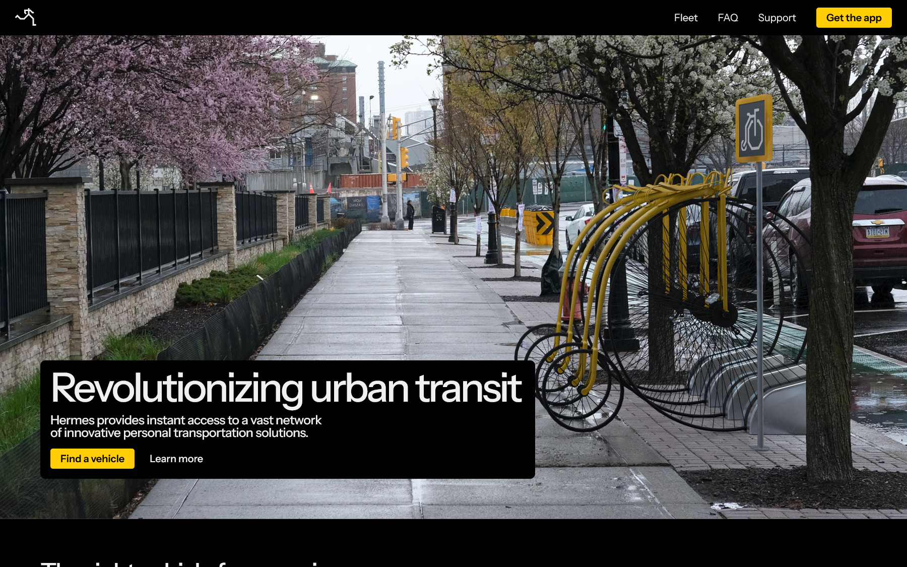

# Hermes

Hermes - серьёзный сервис мгновенной аренды
несерьёзных видов траснпорта, от дрезин и мотороликов до лошадиных повозок и персональных мини-дирижаблей. Проект является пародией на стартапы из Кремниевой долины в конце 2010-х годов.

## Ссылка на сайт

[Ссылка](https://ninefivethree.github.io/hermes-landing)

## Скриншот

## Автор

Андреев Данила, БРИЦП262

## Что я научился делать

- Успешно поэксперементировал с композитингом в Blender
- Успешно (?) придумал и реализовал систему дизайна и иконок
- Вспомнил ванильные HTML+CSS после нескольких лет использования фреймворков и тейлвинда :)

## Использование ИИ

ИИ использован не был.

Стоковые изображения взяты с [pexels.com](https://pexels.com/)